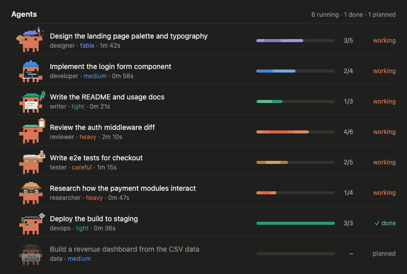
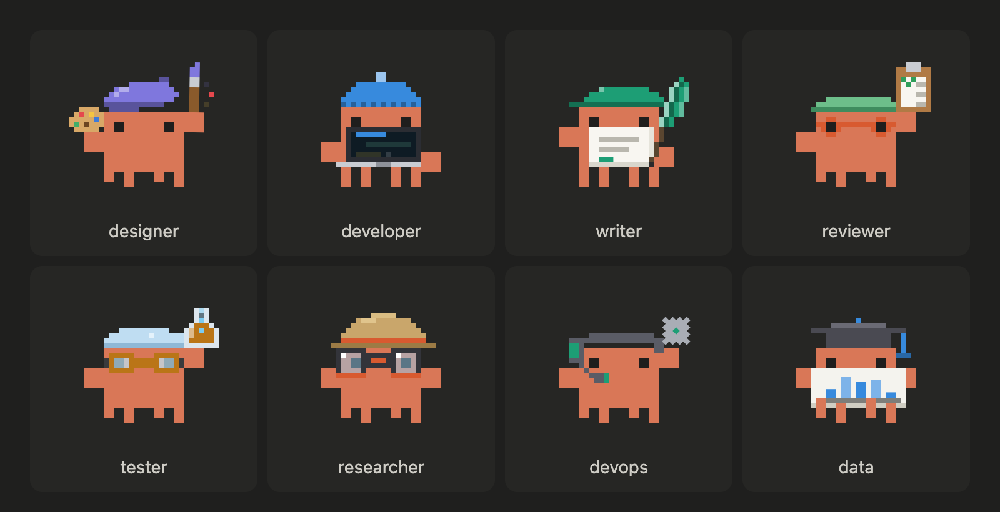

# claude-code-mods

Two Claude Code mods for [savvy-flow](https://github.com/johnnyvizz/claude-kit): an agents panel where each subagent wears a costume for its role, and a prompt prefill so a new session is one task description away from a flow.



*Sprites are rendered from the plugin's own drawing code (`hooks/costumes.ts`). The panel around them is a mock-up of the layout, not a screen recording of Claude Code.* An [MP4 version](assets/costumes-demo.mp4) and a [static grid](assets/costumes.png) are in `assets/`.

## What's inside

| Plugin | What it does | Version |
| --- | --- | --- |
| [`savvy-progress`](plugins/savvy-progress) | Fork of johnnyvizz's progress bar and agents panel. Adds role-based animated costumes. | 1.3.0-roles |
| [`savvy-autostart`](plugins/savvy-autostart) | Pre-fills the prompt with `/savvy-flow:savvy-flow ` so pressing Enter runs the command. | 0.1.0 |

## Requirements

- A recent Claude Code. Tested on 2.1.322 and 2.1.325; 2.1.270 rejects the plugin manifest. Run `claude update` if the install fails with a manifest error.
- `savvy-flow` from [johnnyvizz/claude-kit](https://github.com/johnnyvizz/claude-kit). It is not part of this repo.

## Install

In a Claude Code session:

```
/plugin marketplace add johnnyvizz/claude-kit
/plugin install savvy-flow@claude-kit
/plugin marketplace add benjatestaferri7/claude-code-mods
/plugin install savvy-progress@claude-code-mods
/plugin install savvy-autostart@claude-code-mods
```

Or from a shell:

```sh
claude plugin marketplace add johnnyvizz/claude-kit
claude plugin install savvy-flow@claude-kit --scope user
claude plugin marketplace add benjatestaferri7/claude-code-mods
claude plugin install savvy-progress@claude-code-mods --scope user
claude plugin install savvy-autostart@claude-code-mods --scope user
```

If you already have the original `savvy-progress` installed, disable it. Both draw the same panel and register the same tools:

```sh
claude plugin disable savvy-progress@claude-kit
```

In the desktop app: click **+** next to the prompt box, open **Plugins**, choose **Add marketplace**, and enter `benjatestaferri7/claude-code-mods`. Then install the plugins from the list.

## Usage

- `/savvy-flow:savvy-flow <task>` starts a flow. With `savvy-autostart` the prompt box already contains `/savvy-flow:savvy-flow `, so type the task and press Enter.
- `/agents-info` toggles the agents panel. `/agents-info open` opens it or brings it forward.
- `/autostart on|off|status` controls the prefill; `/autostart` alone toggles it. The setting persists across sessions. The prefix is the `command` option (`/plugin configure savvy-autostart@claude-code-mods`), default `/savvy-flow:savvy-flow`. The box is only filled when it is empty, never in subagents, and only if the command exists.

The panel opens by itself when a savvy-flow worker starts. Panel language and auto-open behavior are options of `savvy-progress`; see [its README](plugins/savvy-progress/README.md#settings).

## Role costumes

Each agent wears a costume for its role. The crab keeps its model-tier colour as an accent (hat, lens ring, chart bars), so the tier stays visible.

| Role | Costume | Animation | Example keywords |
| --- | --- | --- | --- |
| designer | tilted beret, palette, brush | brush strokes, paint dabs blink | design, palette, mockup, typography |
| developer | beanie, open laptop | claws tap, code lines flicker | implement, refactor, bug, fix, api |
| writer | newsboy cap, paper, quill | quill writes, ink line grows | docs, readme, copy, draft |
| reviewer | eyeshade, round glasses, clipboard | check marks appear one by one | review, audit, lint, verify |
| tester | surgical cap, goggles, flask | bubbles rise | test, qa, e2e, coverage |
| researcher | pith helmet, binoculars | binoculars scan side to side | research, analyze, explore, survey |
| devops | headset with mic, gear | gear turns | deploy, docker, pipeline, release |
| data | mortarboard, bar chart | bars rise and fall | data, sql, dashboard, metrics |



Keywords are matched in English and Spanish, ignoring accents and case.

## How role detection works

The role is resolved once, when the agent spawns. First match wins:

1. The subagent type name (without any `plugin:` prefix) against a role name or alias, for example `ui-designer`, `qa`, `frontend-developer`.
2. Keywords in the task description, as whole words. The role with the highest score wins. Generic words such as `write` or `code` count half, and a tie goes to the word that comes first.
3. No match: the original tier costume (astronaut, detective, engineer, chef, racer, and the pirate for `Explore`).

Agents stored by older versions have no role and keep their tier costume. `prefers-reduced-motion` stops all animations.

## Adding a role

1. Add an entry to `ROLES` in [`plugins/savvy-progress/hooks/roles.ts`](plugins/savvy-progress/hooks/roles.ts): name, type aliases, description keywords.
2. Add a costume with the same name to `ROLE_COSTUMES` in [`hooks/costumes.ts`](plugins/savvy-progress/hooks/costumes.ts), drawn as rects on the 30x28 grid. Props that move go in their own group.
3. Add its `.c-<role>.run .<group>` animation to `CRAB_CSS`.
4. Add a case to `hooks/roles.test.ts`.

## Limitations

- savvy-flow spawns Opus and Fable workers, so a flow costs real tokens. The cost figures in the panel are estimates from token counts and a built-in price table, not a bill.
- The fork does not receive upstream updates automatically. Changes from `johnnyvizz/claude-kit` have to be merged by hand.
- The mods draw in the Claude Code terminal UI and desktop app. They do not draw in the VS Code extension's chat panel.
- Costumes are decided at spawn time. A task whose description gives no clear role gets the tier costume.

## Credits

`savvy-flow` and the original `savvy-progress` (progress bar, agents panel, tools, tier costumes) are by [johnnyvizz](https://github.com/johnnyvizz), from [claude-kit](https://github.com/johnnyvizz/claude-kit), MIT. This repo adds the role costumes and `savvy-autostart`.

## License

MIT. See [LICENSE](LICENSE). `plugins/savvy-progress` keeps the original copyright notice alongside the modification notice.
